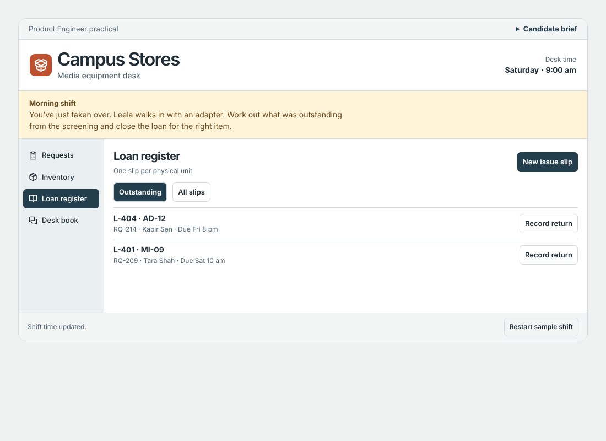
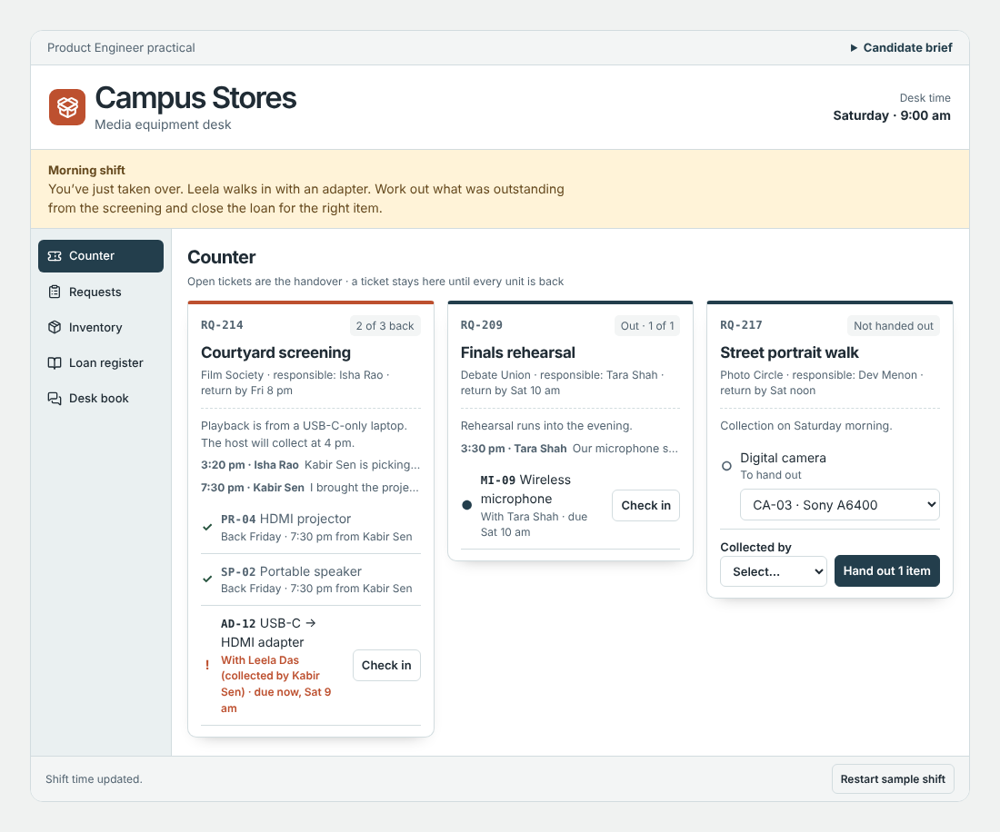

# Campus Stores: the rail is the handover

My submission for the Campus Stores Product Engineer practical. Open `index.html` and the app starts on the new **Counter** screen. Everything else is still there.

**My decision in one line:** keep the per-unit loan register, and make the club's approved request a ticket that stays on the counter until every unit is back. When the plan changes, the change goes on the ticket, not into the chat.

## How my shift went

- **Friday 3:45 pm.** Kabir was at the counter. The most obvious button on screen was **Move to return time**, and I didn't know I was supposed to issue anything. Issuing lives on the Loan register, two clicks away from the Requests screen where the kit is listed. When I found it, I had to fill the same form three times (request, unit, person, return time) for one kit.
- **Friday 7:30 pm.** Kabir brought back the projector and speaker. Leela had the adapter. The only place I could record that was a free-text note in the Desk book.
- **Saturday 9:00 am.** Leela walked in with an adapter. I looked for her in the Loan register and she wasn't there. The slip said `L-404 · AD-12 · Kabir Sen · Due Fri 8 pm`, with no sign it was late and no way to tell which adapter AD-12 was without opening Inventory. The Desk book was the only place that knew the story.

At that point the most useful screen was the Desk book, and a WhatsApp group could do that job.

## A moment the product handles well

**One slip per physical unit.** At 7:30 I closed the projector and speaker slips, and exactly one Film Society slip stayed open: AD-12. The partial return just worked, because nothing was bundled. If the kit had been one slip, "is it returned?" would have had no clean answer.

The issue form also stopped me from making mistakes: it hid the projector in repair (PR-06), refused a second speaker, and refused items that weren't on the club's approved request.

I kept all of this. The new screen is built on top of these slips and rules. My rule from issuing the kit: **the record should be per item, but the action shouldn't be.** Three slips for Kabir is right; three forms to make them isn't.

## A moment I would change

**Saturday 9 am: the record didn't know what the desk knew.** Everything I needed (Leela has it, she's coming at 9, it's the Belkin one from bin C4) was spread across three screens, and the most important part was in chat. The slip still pointed at Kabir.

The root cause shows up at 3:45 as well: the app thinks in single slips, but the desk thinks in a club's kit. So the work isn't where the kit is, and when the plan breaks, the truth moves into chat.

## The idea: an order ticket on a rail

This desk reminded me of a restaurant. Every order is a ticket (a KOT) clipped to a rail above the kitchen. Dishes get ticked off as they go out, and the ticket comes off the rail only when everything on it is done. When a new cook takes over, nobody writes them a note. They read the rail.

So I made the approved request the ticket.

| | What changed | Where you see it |
|---|---|---|
| **The rail is the handover** | A new **Counter** screen opens first, with one ticket per approved request. Tickets that are late, due now, or behind on a club message move to the front. Finished tickets go to the back. | Saturday 9 am: the Film Society ticket is first, with **AD-12 · With Leela Das · due now**. |
| **Who has it now** | A slip keeps who *collected* a unit, and can also say who *has it now*. Each ticket names who is *responsible* (the person who filed the request). | The adapter line reads "With Leela Das (collected by Kabir Sen)". Inventory says who has each unit on loan. |
| **Messages become changes** | A club's message shows on its own ticket. If it changes a record, the ticket offers that change as one button, and stays flagged until someone presses it. | Friday 7:30: **Put on record: AD-12 with Leela Das, back Sat 9 am**. At 3:45, Isha's message pre-fills **Collected by: Kabir Sen**. |

Handing out the kit also moved onto the ticket: pick the collector and press **Hand out 3 items**. The app still writes one slip per unit, takes the return time from the request, and only offers working units of the approved types, with model names.

The **Loan register** form changed the same way: **New issue slip** now takes several units at once and still writes one slip per unit. The whole kit is checked before anything is issued, so it goes out complete or not at all.

## The same job, using the change

| Original, Saturday 9 am | With the Counter, Saturday 9 am |
|---|---|
|  |  |

1. **3:45 pm.** The Film Society ticket says *Not handed out* and lists PR-04, SP-02 and AD-12 with their models. Collected by is already Kabir, as Isha asked. One press hands out all three. ([screenshot](docs/counter-friday-345pm.png))
2. **7:30 pm.** Check in the projector and speaker. Kabir's message is on the ticket. One press puts "AD-12 with Leela Das, back Sat 9 am" on the slip. ([screenshot](docs/counter-friday-730pm.png))
3. **9:00 am.** The morning shift opens the app and the Film Society ticket is at the front: AD-12, with Leela, due now. **Check in** shows the tag and model to match against the adapter in her hand (AD-12 · Belkin AVC002 · bin C4), with "Handed back by" set to Leela. One press closes the right slip, and the ticket moves to the back as *All back*.

The morning shift never had to open the Desk book.

## What I kept on purpose

- One slip per physical unit, and every rule on the issue form.
- The Requests, Inventory, Loan register and Desk book screens. The Desk book shows exactly what it showed before.
- **The visual language.** I reused the original colours, type and components on purpose, so the Counter reads as the same product, improved. The brief is about the job at the counter, so I changed the workflow, not the paint. A bolder counter-first look is something I'd explore next.
- The original **New issue slip** form, as a fallback for anything that isn't on a ticket (it now accepts several units at once).

## What I noticed but didn't change

- **A return goes straight back on the shelf.** Nothing in the app can put an item into repair; PR-06 is in repair only because the starting data says so. A return is the only moment you'd spot damage. Next on my list, but it's a separate problem.
- **No undo** on a check-in. The check-in step now shows what you're closing and asks who handed it back, which covers the main risk.
- **Club messages carry their change as data** in this prototype. At a real counter, staff would type the change themselves or confirm a suggested one. The point is that the change lands on the ticket, not how it's entered.

## How I'd know it helped

Watch the first return of the morning shift at a real counter. **Does the person on shift open the Desk book, or ask a colleague, before closing the loan?** If they can close it from the ticket alone, the rail is doing the handover. If they still check the chat, the ticket isn't carrying enough.

## Run the app

Open `index.html` in a modern browser. It needs no build step and works offline.

To serve it over local HTTP instead, run this from the repository folder and visit `http://localhost:8000`:

```sh
python3 -m http.server 8000 --bind 127.0.0.1
```

**Restart sample shift** restores the fictional starting records. The saved-shift key moved to `campus-stores.shift.v2`, so an older saved shift from the original app starts fresh.

## Source

- `index.html`: the desk layout, candidate brief, and bundled icons. It adds one icon (`ticket`) for the Counter.
- `app.js`: the sample records and interactions. The Counter is in `lines`, `line`, `ticket` and `counter`. Club messages are now data (`messages`), which both the Desk book and the tickets read. Due times map to desk-clock minutes (`dueAt`) so the app can tell *late* from *due now*.
- `styles.css`: the desktop and mobile layouts. The Counter styles are at the end of the file.
- `docs/`: screenshots used in this README.

Icon license notices are in [third-party/lucide-LICENSE.txt](third-party/lucide-LICENSE.txt).
